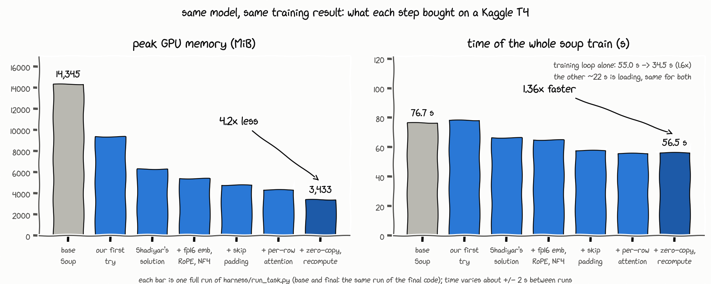

# a s1mple solution

**4× less memory, 1.36× faster, same model.** Soup's training run on a free Kaggle T4, rebuilt
around our own Triton kernels.

Team **NaVi** · Soup Kernel Challenge · Decentrathon 6.0

The task: take one fixed `soup train` run (Qwen2.5-1.5B-Instruct, 4-bit NF4, LoRA r=16 on q/v,
batch 4, 64 steps, one T4) and make it lighter or faster without changing what it learns. We made it
both. Everything is in `solution/`.

| | Base Soup | Ours | |
|---|---|---|---|
| Peak GPU memory | 14,345 MiB | **3,433 MiB** | **4.18×** less |
| Whole `soup train` command | 76.7 s | **56.5 s** | **1.36×** faster |
| … just the training loop | 55.0 s | **34.5 s** | **1.60×** faster |
| Eval loss (held-out rows) | 2.04968 | 2.04950 | −0.009 %, same model |
| All 10 checks (`harness/check_rules.py`) | | **pass** | |

These come from one Kaggle T4 run of `harness/run_task.py` + `check_rules.py` on our final code
(`68f44c2`). About 22 s of every run is loading (Python, Soup, the 4-bit model), and that part is the
same for the base and for us. That's why the whole command gains less than the training loop does.



**Kaggle notebook (public, saved version):** TODO <link>

---

## How we got here

Two of us went at it separately at first. Yerkhan wrote the first set of kernels (fused loss, NF4
unpacking, RMSNorm, RoPE): 1.53× less memory, but no speed at all. Shadiyar came back the same
evening with a different idea: never build the logits table at all.
That gave 2.27× memory and 1.18× speed, so his version became the base and we built everything else
on top of it, through the night and the next morning.

The rule we kept: measure first, change one thing, run the full checks, keep it only if it passes
and helps. Every row in the [results table](#3-results-and-limitations) is one of those runs.

## 1. What we did

`solution.apply()` runs before Soup builds the model and patches transformers, peft, bitsandbytes,
TRL and Soup so training goes through our code. Before touching anything we looked at what the run
actually does (a GPU profile of every kernel, a list of every tensor autograd keeps for the backward
pass, a timeline of the run), then went after the biggest thing first.

### The ideas, biggest first

**1. Never build the 2,048 × 151,936 logits table** (`head_loss.py`). The LM head and the loss run
together, 256 rows at a time. One Triton kernel reads a chunk of logits and gets the per-token loss,
entropy and argmax with an online softmax, then overwrites the chunk with the gradient
`(softmax − onehot)`. The gradient for the hidden states (`dlogits @ W`) comes out of the same pass.
TRL's entropy and token accuracy and Soup's per-row rewind losses are filled from these values, so
Soup's outputs stay the same.

**2. Stop computing padding** (`unpad.py`). A batch is 4 rows padded to the longest one, and on this
data only **57 %** of the token slots hold real tokens. The model was normalizing, projecting and
running the MLP on all the padding too. We pack the real tokens into one row and run every
per-token operation (norms, all projections, LoRA, MLP) on them only:

```
padded [4, T, 1536]  ──pack──►  [1, N_real, 1536]  ── 28 layers ──►  scatter back to [4, T, ·] for the loss
                                       │
                         attention: one causal SDPA call per row, on that row's tokens only
```

- **Attention, one row at a time.** TRL pads on the right, so each row's tokens sit together.
  PyTorch's fused attention runs once per row with plain causal masking: no mask tensor, no padding,
  and the quadratic part only over the real length.
- **No copies for the shared heads.** Qwen has 12 query heads but only 2 key/value heads. Instead of
  copying k/v up to 12 heads (and keeping those copies around for the backward pass), we group the
  query heads as `[2, 6, L, D]` and broadcast each k/v head with a zero-copy view. If you ask SDPA for
  its own GQA mode, it quietly falls back to the slow math kernel on a T4. We found that out the hard
  way (+700 MiB in one run) and now guard against it.
- **LoRA dropout draws exactly the base's random numbers.** The mask is drawn on a padded tensor of
  the same shape and dtype the base run uses, then packed. A test checks it's bit-identical.
- Batches that aren't right-padded take a fallback: q/k/v are scattered back and the original masked
  attention runs.

**3. Keep the heaviest batch in check** (`unpad.py`). Peak memory is decided by the single densest
step, and the MLP's saved gate/up tensors are about two thirds of what a layer keeps for the backward
pass. When a batch has more than 1,000 real tokens, just enough layers recompute gate/up during the
backward pass (keeping only their input) to bring that batch down to the level of a 1,000-token one.
Smaller batches recompute nothing, so the time cost stays tiny. It's the same kernels recomputing the
same values, so the gradients don't change.

**4. Our own NF4 unpacking, both directions** (`nf4.py`). bitsandbytes unpacks every 4-bit weight to
fp16 before every matmul. Our kernel works on whole quantization blocks as 2-D tiles, decodes each
scale once per block instead of once per byte, and writes contiguous rows: **1.9× faster** than
bitsandbytes' own unpack on the real layer shapes (`tools/bench_nf4.py`). bitsandbytes 0.50 runs the
forward matmul through a fused op that never calls `dequantize_4bit`, so we route
`MatMul4Bit.forward` through our unpack too.

**5. Free wins from dtypes.**
- The tied embedding / LM head (151,936 × 1,536) is stored once in fp16, instead of fp32 plus a fresh
  fp16 copy every step (`embed_fp16.py`). The checkpoint is bf16, and every value fits fp16 exactly:
  the run logs "0 of 233,373,696 values changed".
- RMSNorm writes fp16 directly for the projections that use fp16 anyway, and we skip peft's
  fp16 → fp32 → fp16 round trip before LoRA (`rmsnorm.py`).

**6. Small fused kernels.** RMSNorm forward/backward, the residual add fused with the post-attention
RMSNorm (`rmsnorm.py`), and rotary embeddings forward/backward (`rope.py`).

### Our kernels

| `@triton.jit` kernel | File | What it replaces |
|---|---|---|
| `_head_ce` | `head_loss.py` | LM head logits + log-softmax + NLL + entropy + argmax + their backward, per 256-row chunk |
| `_nf4_unpack` | `nf4.py` | bitsandbytes' NF4 unpack (scale decode + weights), forward and backward |
| `_rms_fwd`, `_rms_bwd` | `rmsnorm.py` | Qwen2 RMSNorm, about six PyTorch ops per call |
| `_add_rms_fwd`, `_add_rms_bwd` | `rmsnorm.py` | residual add + post-attention RMSNorm (+ the gradient add in backward) |
| `rope_kernel` | `rope.py` | `rotate_half`, cat, two multiplies and an add, for q and k, forward and backward |

Together they take **about 12 %** of the training time (check 4 asks for 5 %). Three more,
`_ce_fwd`, `_ce_bwd` and `_entropy_fwd` (`fused_ce.py`), don't launch in a normal run; they're the
fallback if the fused head path can't run. `solution/swiglu.py` is the challenge's example and still
runs, but its kernels don't count as ours.

### What we tried and threw away

- **A lower recompute budget** (700 tokens instead of 1,000): 3,013 MiB (4.76×), but about 3 s
  slower. Under the scoring formula 1,000 was the better trade.
- **Turning the fused add-norm off** to save two compiles: compiling got about 1 s cheaper, but the
  run wasn't measurably faster, so it stayed on.
- **SwiGLU in plain PyTorch** to save two compiles: the slower backward would cost more than it saves.

## 2. How to run it

**On Kaggle** (the way the jury runs it):

1. Create a notebook from `templates/kaggle_notebook.ipynb`. Settings: **GPU T4 x2**, **Internet on**.
2. Put this repository's URL in the first code cell (and `COMMIT`, if you want a fixed version).
   For a private repository, add a Kaggle secret `GITHUB_TOKEN` with a read-only token.
3. **Run All** (about 10 minutes). It trains the base and our solution, scores both adapters and runs
   the checks. `runs/solution_1/train.log` shows what our code did: `[solution] OK: ...` for every
   patch, the largest batch and how many layers it recomputed, and a timeline of the run.

**Locally**, on Linux with a CUDA GPU:

```bash
pip install "soup-cli[train]==0.77.0" "transformers==5.16.1" "peft==0.20.0" "trl==0.29.1" \
    "bitsandbytes==0.50.2" "accelerate==1.14.0" pytest
python task/prepare_data.py          # data/train.jsonl, data/eval_public.jsonl
python -m pytest solution -q         # 66 tests: every kernel and patch against PyTorch / bitsandbytes
python harness/run_task.py           # base, then solution -> runs/result.json
python harness/check_rules.py        # the checks -> runs/checks.json
python tools/bench_nf4.py            # optional: our NF4 unpack vs bitsandbytes
```

The tests compare every kernel's forward and backward with PyTorch (the NF4 unpack with bitsandbytes,
value for value), check that the packed dropout draws bit-identical masks, and run a small Qwen2
model through the packed path, the left-padded fallback and the MLP recompute against the original
forward and backward.

## 3. Results and limitations

Every row is a full Kaggle T4 run of `run_task.py` + `check_rules.py` with all 10 checks passing.
Speedup is against the base run of the same session.

| Version | Time | Speedup | Peak memory | Memory ratio | Own-kernel share |
|---|---|---|---|---|---|
| Base Soup (average of 15 runs, 75.9–86.1 s) | 78.5 s | 1.00× | 14,345 MiB | 1.00× | |
| Yerkhan's first solution: fused loss, NF4, RMSNorm, RoPE, fp16 SwiGLU | 78.3 s | 0.99× | 9,384 MiB | 1.53× | 11.8 % |
| Shadiyar's solution: fused LM head + loss, fp16 norm path, NF4 | 66.6 s | 1.18× | 6,323 MiB | 2.27× | 6.3 % |
| + fp16 tied embedding | 69.2 s | 1.15× | 5,423 MiB | 2.65× | 5.9 % |
| + RoPE kernel | 65.3 s | 1.19× | 5,421 MiB | 2.65× | 7.8 % |
| + NF4 kernel on the forward matmul | 65.7 s | 1.18× | 5,421 MiB | 2.65× | 12.3 % |
| + faster NF4 unpack | 65.0 s | 1.20× | 5,421 MiB | 2.65× | 9.2 % |
| + padding removal | 58.0 s | 1.35× | 4,801 MiB | 2.99× | 12.3 % |
| + fused add-norm | 56.1 s | 1.35× | 4,861 MiB | 2.95× | 12.1 % |
| + per-row attention | 55.8 s | 1.43× | 4,367 MiB | 3.29× | 13.2 % |
| + zero-copy GQA, fewer compiles, smaller head chunks | 55.3 s | 1.37× | 4,013 MiB | 3.58× | 12.2 % |
| + MLP recompute on dense batches | 55.5 s | 1.39× | 3,433 MiB | 4.18× | 12.6 % |
| **Final code `68f44c2` (same as above + log lines), verification run** | **56.5 s** | **1.36×** | **3,433 MiB** | **4.18×** | **11.8 %** |

Eval loss stayed within ±0.015 % of the base in every run (the limit is +0.5 %), and the loss curve
within 0.05 % (limit 3 %).

**Where the time goes now** (`runs/result.json` and the timeline in the log): the training loop
takes 34.5 s against the base's 55.0 s (1.60×). Outside it, both runs spend about 22 s on Python and
imports, Soup loading the tokenizer, data and 4-bit model, and saving. Inside our loop, the first two
steps take about 6.5 s because Triton compiles our kernels on first use; after that a step takes
about 0.45–0.5 s (the base's median step: 0.88 s).

**Limitations, honestly:**

- **Noise.** Each row is one run. Time varies about ±2 s between runs (the base alone ranged
  76–86 s), and back-to-back runs on the same Kaggle GPU got slower over the morning, so speed
  differences under ~5 % between rows don't mean much. Memory is stable to a few MiB.
- **Fixed overhead caps the speedup.** About 20 s per run is loading that the base pays too, and
  compiling our kernels costs about 5–6 s that the base doesn't.
- **Per-row attention relies on right padding** (what TRL's collator produces); other layouts use the
  slower masked fallback. The MLP recompute trades a little time for memory and only kicks in on
  batches above 1,000 real tokens.
- **Built for this setup.** The fp16 embedding relies on the checkpoint's values fitting fp16 (checked
  and logged at start-up), and the kernels are tuned for Qwen2.5-1.5B (hidden 1,536, head dim 128) on
  a T4 in fp16 autocast. On other models our guards fall back to the original code where they don't
  match.
- **Not done yet:** recomputing more of the saved activations (fp32 residual stream, LoRA inputs),
  cutting the compile time further, and a varlen attention kernel of our own.

## Team

| Name | Role | GitHub | Kaggle | Telegram |
|---|---|---|---|---|
| Yerkhan Serik (captain) | kernels, integration, measurement, README | [evilandangry](https://github.com/evilandangry) | [yerser](https://www.kaggle.com/yerser) | [@metalballadlover](https://t.me/metalballadlover) |
| Shadiyar Musin | the core solution: fused LM head + loss, fp16 norm path, NF4, fp16 embedding, fused add-norm; also the team name | — | — | — |
| Madiyar Komilzhonov | presentation | — | — | — |
| Mansur Utepbergen | team member | — | — | — |

## Credits and sources

- **AI assistance.** The challenge allows AI agents. We used Claude (Anthropic) and other AI
  assistants for writing kernels, tests and this README. Every change was run on a Kaggle T4 and kept
  only if all checks passed.
- **Ideas we used, with sources** (we wrote the code ourselves; nothing was copied from other
  projects):
  - online softmax: Milakov and Gimelshein, [Online normalizer calculation for softmax](https://arxiv.org/abs/1805.02867) (2018);
  - fusing the LM head with the loss so the logits are never stored: the "fused linear cross-entropy" in
    [Liger Kernel](https://github.com/linkedin/Liger-Kernel) and Apple's
    [Cut Your Losses in Large-Vocabulary Language Models](https://arxiv.org/abs/2411.09009) (2024);
  - removing padding inside a batch: the "unpadding" / varlen approach used by
    [FlashAttention](https://github.com/Dao-AILab/flash-attention);
  - recomputing activations instead of storing them: Chen et al.,
    [Training Deep Nets with Sublinear Memory Cost](https://arxiv.org/abs/1604.06174) (2016);
  - the NF4 format: Dettmers et al., [QLoRA](https://arxiv.org/abs/2305.14314) (2023);
    RMSNorm: Zhang and Sennrich, [Root Mean Square Layer Normalization](https://arxiv.org/abs/1910.07467) (2019).
- Built on the Soup Kernel Challenge starter kit, [Soup](https://github.com/MakazhanAlpamys/Soup)
  `soup-cli==0.77.0`, PyTorch, Triton, transformers, peft, TRL and bitsandbytes.
- The hand-drawn chart uses matplotlib's xkcd style and the open-source
  [xkcd-script font](https://github.com/ipython/xkcd-font).

## License

Apache-2.0, see `LICENSE` and `NOTICE`. The five test files come from Soup v0.77.0 (Apache-2.0).
Data: [AmanMussa/kazakh-instruction-v2](https://huggingface.co/datasets/AmanMussa/kazakh-instruction-v2)
(MIT on its card), a Kazakh translation of [Stanford Alpaca](https://huggingface.co/datasets/tatsu-lab/alpaca)
(CC BY-NC 4.0); it is downloaded at run time for this benchmark. Model:
[Qwen/Qwen2.5-1.5B-Instruct](https://huggingface.co/Qwen/Qwen2.5-1.5B-Instruct) (Apache-2.0).
